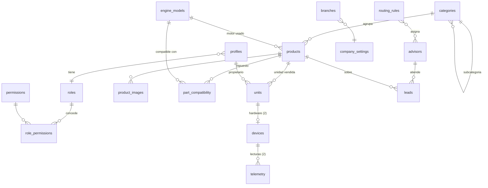

# 02 · Arquitectura — JF Motores

## 1. Stack y por qué

| Capa | Tecnología | Razón |
|---|---|---|
| Web + API | **Next.js (App Router) + TypeScript** | Páginas renderizadas en servidor (SEO y velocidad para tráfico de anuncios), API en el mismo proyecto, el framework con mejor soporte de herramientas de IA para que lo mantengas tú solo |
| Base de datos | **Supabase Postgres** | Relacional (catálogos, compatibilidades, roles), permisos por fila (RLS), copias de seguridad |
| Usuarios | **Supabase Auth** | Login de admin/editores/asesores y clientes con el mismo sistema |
| Archivos | **Supabase Storage** | Imágenes y modelos `.glb`; buckets públicos (catálogo) y privados (documentos) |
| Hosting | **Vercel** | Despliegue automático desde GitHub, vista previa por cada cambio, país del visitante en cada petición (`x-vercel-ip-country`) |
| Idiomas | **Diccionarios nativos de Next.js** (`next/root-params`) | Rutas por idioma (`/es`, `/en`, `/pt`), un JSON por idioma, sin dependencias extra y compatible con la caché de Next.js 16 |
| 3D inicio | **Three.js** (motor actual migrado y optimizado) | Cero descargas de modelo, piezas clicables con `Raycaster` |
| 3D por producto | **`<model-viewer>`** | Visor de `.glb` listo (rotar, zoom, AR en móvil), carga solo cuando se abre |
| Validación | **Zod** | Mismas reglas en formularios y API |
| Pruebas | **Vitest** (lógica) + **Playwright** (flujos) + GitHub Actions | Nada llega a producción sin pasar pruebas |
| Medición | GA4 + Meta Pixel (+ Conversions API en 1.1) | Atribución de anuncios |

**Descartado:** Express + JSON local (pierde datos en servidores efímeros), arquitectura "hexagonal" con dos bases de datos (doble mantenimiento), Google AI Studio como hosting (no es para producción).

## 2. Entornos

| Entorno | Dónde | Base de datos |
|---|---|---|
| Local | Tu PC (`npm run dev`) | Supabase proyecto **dev** |
| Pruebas | Vercel Preview (URL automática por rama) | Supabase **dev** |
| Producción | `jfmotores.altalcurnia.com` → luego dominio propio | Supabase **prod** (proyecto separado al lanzar) |

Flujo: rama → Pull Request → pruebas automáticas + vista previa → merge a `main` → producción.

## 3. Estructura del proyecto

```text
jf-motores/
├── docs/                         # Requisitos, arquitectura, plan
├── legacy/                       # index.html original (referencia, no se publica)
├── src/i18n/dictionaries/        # Textos de interfaz: es.json, en.json, pt.json, ...
├── public/                       # logo, imágenes estáticas
├── supabase/
│   ├── migrations/               # Esquema SQL versionado (tablas, RLS, funciones)
│   └── seed.sql                  # Datos iniciales (catálogo de ejemplo)
├── src/
│   ├── app/
│   │   ├── [locale]/             # Sitio público por idioma
│   │   │   ├── page.tsx          # Inicio con motor 3D
│   │   │   ├── motobombas/ motores/ repuestos/   # Catálogos y fichas [slug]
│   │   │   ├── empresa/ sedes/ legal/
│   │   │   └── cuenta/           # Cliente (1.1)
│   │   ├── admin/                # Panel (protegido por rol)
│   │   └── api/                  # leads, tasas de cambio, telemetría (2)
│   ├── components/               # UI compartida
│   ├── features/
│   │   ├── engine3d/             # Escena Three.js, despiece, mapeo pieza→categoría
│   │   ├── catalog/              # Consultas, filtros, ficha, visor 3D
│   │   ├── pricing/              # Detección de país, conversión de moneda
│   │   ├── leads/                # Registro y asignación de asesor (motor de reglas)
│   │   └── admin/                # Formularios CRUD, permisos
│   ├── lib/supabase/             # Clientes (navegador, servidor, admin)
│   └── i18n/                     # Configuración de idiomas
└── tests/                        # unit/ e2e/
```

## 4. Modelo de datos (Postgres)



| Tabla | Campos clave |
|---|---|
| `roles`, `permissions`, `role_permissions` | Permisos granulares editables por el Administrador |
| `profiles` | `id` (= usuario Auth), nombre, teléfono, país, `role_id` (cliente por defecto) |
| `categories` | `catalog` (motobomba/motor/repuesto), `parent_id`, `slug`, `name` (JSON por idioma), `engine_part_key` (pieza del 3D), orden |
| `engine_models` | marca, modelo (p. ej. "Kubota V2203") — base de la compatibilidad |
| `products` | `catalog`, `category_id`, `ref`, `slug`, `name`/`description` (JSON por idioma), `price_cop`, `status` (borrador/disponible/vendido), `specs` (JSON: hp, succión, descarga, caudal, cabeza…), `engine_model_id`, `model_glb_path`, `published_at` |
| `product_images` | ruta, texto alternativo por idioma, `is_reference`, orden |
| `part_compatibility` | repuesto ↔ modelo de motor (y opcional ↔ producto concreto) |
| `units` | número de serie, producto, `owner_id`, fecha de venta, asesor que vendió |
| `devices`, `telemetry` (2) | clave del dispositivo (hash), lecturas con fecha y JSON |
| `advisors` | nombre, cargo, funciones, foto, `phone_e164`, idiomas, países, catálogos, horario (JSON), peso, activo, `profile_id` (si inicia sesión) |
| `routing_rules` | prioridad, condiciones (JSON), estrategia (fija/rotación/ponderada/elección), asesores, activa |
| `leads` | producto, catálogo, asesor, país, idioma, precio y moneda mostrados, UTM, visitante/cliente, estado, notas, datos de formulario |
| `company_settings` | fila única: razón social, NIT, textos por idioma, cifras, garantía, redes |
| `branches` | sedes |
| `exchange_rates` | moneda, tasa desde COP, manual sí/no, actualizada |
| `forms` (1.1) | campos (JSON), activo, ubicación |
| `audit_log` | quién cambió qué y cuándo (panel admin) |

## 5. Seguridad

- **RLS en todas las tablas.** Público: solo lee productos publicados, categorías, empresa, sedes, asesores activos (sin datos internos).
- Leads: se insertan solo desde la API del servidor (con límite por IP). Asesor ve los suyos; Administrador todos.
- `telemetry` y `units`: solo el propietario y el Administrador (`owner_id = auth.uid()` o permiso `telemetria.ver_todo`).
- Permisos comprobados con una función SQL `has_permission('productos.editar')` usada en RLS y en el servidor.
- Subidas: imágenes ≤ 5 MB (jpg/png/webp), modelos `.glb` ≤ 15 MB; se sirven desde CDN.
- Login con límite de intentos; el panel exige rol interno.

## 6. Decisiones técnicas puntuales

- **Precio por país:** tasa diaria desde una API de tasas de cambio guardada en `exchange_rates` (tarea programada en Vercel); el precio se calcula en servidor según `x-vercel-ip-country` o la elección del visitante (cookie).
- **3D clicable:** cada grupo del motor tiene `userData.partKey` (`radiador`, `culata`, `tanque`…). Al hacer clic en el despiece se consulta `categories.engine_part_key` y se navega a esa categoría. Piezas nuevas se agregan en el código del modelo; el mapeo se edita en el admin.
- **Reemplazo futuro por modelo realista:** el componente acepta un `.glb` cuyos nodos se llamen `part_<clave>`; misma lógica de clic.
- **Asignación de asesor:** función de servidor pura (entrada: producto, país, idioma, hora, visitante → salida: asesor) con pruebas unitarias por cada regla.
- **IoT (2):** endpoint de ingesta autenticado por dispositivo; si la frecuencia de datos es alta se evalúa un servicio de series de tiempo aparte.
